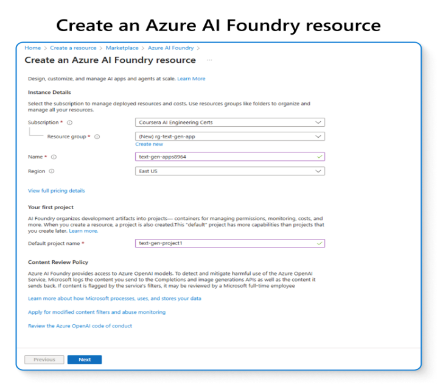
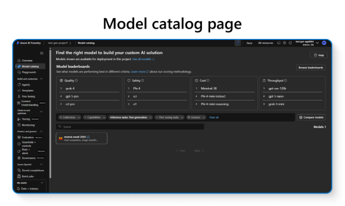
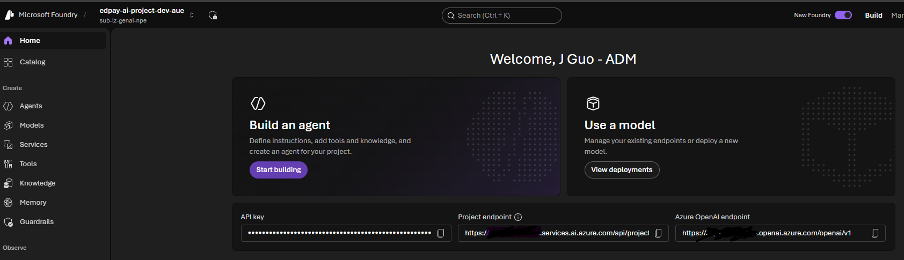

## Create the resource

* Once you sign into Azure, you'll see the main dashboard for the Azure Portal. Under Azure services, select Create a resource.

* In the search bar, type “Microsoft Foundry” and press Enter.

* Select Microsoft Foundry from the results, then select Create on the overview page.

* You're now on the Basics tab, with several fields to fill in:

* Subscription: change this if you need a different Azure subscription.

* Resource group: select Create new, type rg-text-gen-app, and select OK.

* Name: name your Foundry resource text-gen-apps followed by a random 4 or 5-digit number (e.g., text-gen-apps7394) — this name must be unique across Azure.

* Region: choose the Azure region closest to you.

* Default project name: name it text-gen-project1.

* Select Next to skip through the remaining tabs until you reach Review + Submit.

* Once validation finishes, select Create.

* When you see “Your deployment is complete,” select the blue Go to resource button.

    

* Now that you're inside your Foundry resource, select the blue Go to Microsoft Foundry portal button.

## Choose and deploy a Model

* The next step in building your text generation app is to choose a model.

* Select Model catalog, scroll down, and select the Inference task filter.

* Scroll or type “text generation” in the search bar, then select Text generation.

* Select the text generation model gpt-5.4-mini.

    

* In the top left, select Use this model.

* In the pop-up, review the Overview and Pricing and terms tabs, then select Agree and Proceed.

* In the deployment pop-up, keep the Deployment name and Deployment type fields as they are. Just confirm Deployment type is set to Global Standard, then select Deploy.

* You'll know deployment is finished when the Provisioning state under Deployment info shows Succeeded.

## Set up VS Code

* Open VS Code. 

* Open the Text-Generation-App folder (from the zip file you downloaded earlier) inside VS Code. 

* Open the Python file called text_gen.py. 

* Create a virtual environment for this project — an isolated space for its Python packages. Give it a short, clear name.

## Install dependencies and connect your credentials

* Select the requirements.txt file to see the dependencies you'll install.

* Copy pip install -r requirements.txt and paste it into the terminal, then press Enter.

* This installs three packages: streamlit(runs the pre-built interface), python-dotenv (reads your .env file), and azure-ai-inference (calls your deployed model).

## Connect your credentials

* Open the Microsoft Foundry page and check the three tabs above Getstarted: set Language to Python, SDK to Azure AI Inference, and Authentication type to Key authentication.

* Copy the Key from the Endpoint section of Microsoft Foundry, then in VS Code, open the .env file and paste the key over PasteKeyHere.

* Copy the Target URI from the same Endpoint section, then paste it over PasteTargetURIHere in the .env file.

    

* Delete this text from the end of the Target URI:/chat/completions?api-version=2024-05-01-preview— the API version is already set in the code. Your final endpoint should end at/models.

* Confirm the api-version shown in the Target URI before you deleted that text matches the api_version set in text_gen.py. If they don't match, update text_gen.py to the correct version.

## Set the stage with a system message

The system message tells the AI what its job is. It sets the overall tone and purpose for all its responses.

* Select the text_gen.py file.

* Navigate to the SystemMessage class.

* Copy the system message below and paste it inside the quotation marks:

    "You are an AI assistant that provides insightful and inspiring motivational quotes. Your goal is to uplift and encourage users. You should always be positive and thoughtful. Do not generate quotes that are generic or cliché."

## Craft your first prompt (zero-shot prompting)

A “zero-shot” prompt is a direct request where you don't give the model any examples to follow. Let's start with a simple one.

* In the UserMessage class, type: “Tell me a quote about perseverance.”

* Press Enter or select Send.

Review the output. Is it motivational? Does it follow the instructions from the system message? It's probably a good start, but we can make it better.

## Improve the prompt with more detail

Good prompts are specific. Let's add more context to guide the model better.

* In the UserMessage, try this more detailed prompt: “I'm an artist feeling discouraged with my work. Give me a powerful quote about perseverance for the creative field.”

Compare this output to the first one. Notice how adding context about the user (“an artist feeling discouraged”) helps the AI generate a more relevant and empathetic response.

# Connect the backend model to a prebuilt interface

Now that you've sent requests to your deployed model using raw code, you're ready to connect to the prebuilt user interface.

* In VS Code, select user_interface.py. The instructions at the top explain how to run the prebuilt interface, built with Streamlit.

* Copy streamlit run user_interface.py, paste it into the terminal, and press Enter.

* A new browser window opens with the Text Generation App interface — a text box and send button, similar to Foundry Playgrounds.

Note: if a new window doesn't open automatically, this address only becomes active while your Streamlit app is running in the terminal — Ctrl + Click http://localhost:8501there once the app has started.

* If it's not already open, select the two-arrow button in the top left to open the Configuration tab, where you can adjust model settings and the system message.

Note: this tab also includes a Model Parameters section — leave it alone for this lab, since changing model parameters is beyond scope here.

__A note on screen privacy__

The Configuration tab's Endpoint field displays as plain text, not masked like the API Key field. If you're screen-sharing or recording, keep that in mind before opening this tab.

* Copy the original system message from Step 5 and paste it into the system message field of the prebuilt interface. Select Update Configuration (or press Ctrl + Enter) to finalize it, then move on to Step 9.

Optional: scrolling to the bottom of the Configuration tab shows Chat Controls, letting you clear the chat or export the conversation (exporting requires at least 2 messages sent). This isn't required—it's there if you want to keep a record of your testing.

## Control the putput format

Real applications need structured data. You can ask the model to format its output directly in the prompt.

* Enter this prompt:“Generate a quote about the importance of teamwork. Format the output like this: Quote: [The quote] Author: [The author's name]”

Observe the result. The model should follow your formatting instructions — useful whenever an application's interface needs to display information in a specific way.

